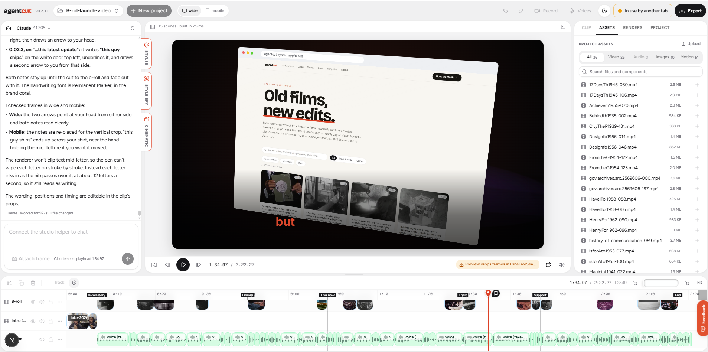

# Agentcut

**Edit video with a prompt.** Agentcut is an open-source video studio: you chat, and
Claude Code or Codex builds the video on your computer as real [Remotion](https://www.remotion.dev) code.
You watch the live preview, scrub the timeline, tweak any layer by hand, and export an MP4 from the browser.



**Try it:** https://agentcut.synteq.app · [components](https://agentcut.synteq.app/components) · [templates](https://agentcut.synteq.app/templates) · [changelog](CHANGELOG.md)

- **Chat to edit**: describe the change; the agent writes the scenes, layers, captions and sound.
- **Style Spy**: paste an Instagram, TikTok, YouTube or X link (or drop a video) and copy its editing style:
  layouts and split screens, cut rhythm, captions, motion graphics, transitions and color.
- **Record**: record talking-head takes from your camera right in the studio, then tell the agent what to do.
- **Edit by hand**: timeline, inspector, components, templates and video styles; export an MP4 in the
  browser or locally with Remotion.

### Search and social sharing

Set `NEXT_PUBLIC_APP_URL` to the production origin **before building** when hosting on another domain.
It controls canonical links, Open Graph URLs, structured data, and the sitemap.
`/sitemap.xml` lists the public pages and all motion components. `/robots.txt` links to it.
The local `/studio` page has `noindex` and is excluded from the sitemap.

The 1200 × 630 share image is `public/og/agentcut.jpg`. Page titles, descriptions, and share
metadata use `lib/seo.ts`. After deployment, submit `/sitemap.xml` in Google Search Console
and check a shared link in the social platforms you use. Search indexing and cached social
previews are controlled by those services.

## How it works

```
 browser (agentcut.synteq.app)            your computer (npx agentcut)
 ┌──────────────────────────────┐         ┌───────────────────────────────────┐
 │ chat · preview · timeline    │◀──ws───▶│ helper on 127.0.0.1:32118          │
 │ inspector · browser export   │         │  ├ Claude Code / Codex (your login)│
 └──────────────────────────────┘         │  ├ workspace: ~/Agentcut/projects  │
                                          │  └ agentcut MCP tools for the agent│
                                          └───────────────────────────────────┘
```

The studio uses a local helper: your agent and API keys stay on your computer. The page connects to
the helper on `127.0.0.1`, the agent writes scenes and layers, and the page rebuilds the preview live.
Project files stay local unless you choose to share them with a link.

## Quick start

1. Install [Node.js LTS](https://nodejs.org/en/download) (20.10 or newer), then
   [Claude Code](https://claude.com/claude-code) or [Codex](https://developers.openai.com/codex/cli),
   and sign in once.
2. Start the helper:

   ```bash
   npx -y agentcut
   ```

3. Open https://agentcut.synteq.app/studio in Chrome and start chatting. When Chrome asks to let the page
   access devices on your local network, click **Allow**: that is how the page reaches the helper.

Helper options:

```bash
npx -y agentcut --dir D:\videos              # workspace folder (default ~/Agentcut)
npx -y agentcut --agent codex                # start the chat with Codex
npx -y agentcut --add-dir path/to/your-app   # let the agent read your app's code (remembered)
npx -y agentcut --no-bash                    # no shell commands for the agent
npx -y agentcut --allow-domain cdn.example.com  # let Claude Code's sandboxed shell reach another site
```

Agents run without asking before each command, so they are sandboxed. Claude Code's shell writes only to the
workspace, reaches only npm and the agent's sound sources, and can't read logins or keys (macOS, and Linux with
`bubblewrap` and `socat`; **Windows has no sandbox, so use `--no-bash` with files you don't trust**). Codex's shell
writes only to the workspace, but it can read your files and reach any site unless you pass `--no-bash`.

Voice-over (ElevenLabs, Gemini, OpenAI, xAI) and music generation (Gemini Lyria) use your own keys,
entered in the studio and kept in your user folder.

Style Spy downloads references with [yt-dlp](https://github.com/yt-dlp/yt-dlp) and
[ffmpeg](https://ffmpeg.org): the helper fetches both on first use into `~/.agentcut/tools` (checksums
verified, nothing installed system-wide) and keeps yt-dlp up to date. Only public videos are downloaded,
unless you click **Retry with my browser login**, which uses that browser's login once for that video.
Record needs camera and microphone access in the browser.

## Share a project

When sharing is configured, click **Share** to create an encrypted project link. Anyone with the
complete link can import the project into their own Agentcut workspace. Links expire after 3 days
and support projects up to 1 GB. Renders and chat history are excluded.

The helper encrypts the files before upload. The key is in the link's `#` fragment and is not sent
to the share service. Keep the complete link private. Shared projects contain code; only open links
from people you trust.

Both users need helper 0.2.12 or newer. For self-hosting, deploy the
[share Worker](workers/share/README.md) and set `NEXT_PUBLIC_SHARE_API_URL` before building the site.
The Share button is hidden when this setting is empty.

## Versions

The studio shows its version next to the logo (hover for the helper's). The editor and the helper are
released together with the same version number; [CHANGELOG.md](CHANGELOG.md) lists what changed. When the
page needs a newer helper, the connection badge says **Update helper**: stop it and run
`npx -y agentcut@latest`.

## Develop

```bash
npm install
npm run helper:build   # build the helper (the agent's MCP server runs from packages/agentcut/dist)
npm run helper         # start the helper from source
npm run dev            # http://localhost:3000 (landing), /studio, /components, /templates
npm run test:share     # share Worker and helper regression tests; no Cloudflare account required
```

- Restyle: the theme is plain shadcn tokens in `app/globals.css` (`:root` / `.dark`). Components are in `components/ui`.
- Studio UI: `components/studio`, logic in `lib/studio`.
- Motion component library: `motion/components` (see its README). After changing it or `skills/agentcut`,
  run `npm run sync:skill` so the helper ships the new copy.

### Local render performance

Local renders use up to two workers by default, with fewer workers when free memory is low.
Media caches are bounded independently; these limits do not cap Chrome's total graphics memory.
To compare worker counts, set `AGENTCUT_RENDER_CONCURRENCY` before starting the helper. It must
be a positive integer no greater than the available CPU count; available memory can reduce it.
Use the same short frame range when comparing settings, since more workers can increase memory
pressure and make complex scenes slower. The helper log records settings, progress, and elapsed time.

Run `node --import tsx --test tests/render-policy.test.mjs` to check worker selection and progress parsing.

### Releasing

1. Add the changes under **Unreleased** in `CHANGELOG.md`, then move them to a new version heading.
2. Bump `version` in `package.json` (editor) and `packages/agentcut/package.json` (helper) to the same
   number. If the page now needs the new helper, raise `MIN_HELPER_VERSION` in `lib/version.ts`.
3. Commit, tag `vX.Y.Z`, push, and publish the helper: `cd packages/agentcut && npm publish`
   (it syncs the skill and builds first). Publish the helper before the site deploys when the page needs it.

## Deploy

The site is a Next.js app with no backend; the `Dockerfile` builds a standalone server that listens on
`$PORT`, with a `/healthz` route for health checks. On [Synteq Apps](https://cloud.synteq.com/apps), link
this repo (root directory `/`); pushes to `main` build the Dockerfile and roll out. Optional build-time
env: `NEXT_PUBLIC_APP_URL`, `NEXT_PUBLIC_MUSIC_CDN_URL`, `NEXT_PUBLIC_BROLL_CDN_URL`,
`NEXT_PUBLIC_SHARE_API_URL` (see `.env.example`). The b-roll
catalog is built and uploaded with `scripts/broll-index` (see its README).

```bash
docker build -t agentcut-web . && docker run -p 3000:3000 agentcut-web
```

If you host the page on another origin, start the helper with `--origin https://your-host` (or set
`AGENTCUT_ORIGINS`) so it accepts that page.

## License

MIT. The landing page background uses [Gradient ASCII](https://reactbits.dev/backgrounds/gradient-ascii)
from React Bits by David Haz (MIT + Commons Clause), see `components/site/GradientASCII.tsx`.
